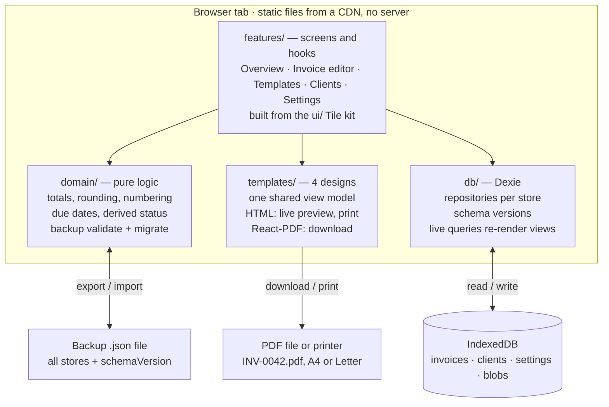

# Tagy — Build Plan

17 Oct 2026 · Irsyad

## Overview

Tagy is a free, local-first invoice maker: a static React app that stores everything in IndexedDB and ships in 6 phases, with a usable invoice-to-PDF path by the end of phase 3. This plan is built from the Pencil file `tagy.pen` (Style C · Tile, v1.0 MVP handoff dated 17 Oct 2026) and follows its scope list as written.

**Principles**

- No account, no backend, no network calls after the app loads. The app is static files on a CDN.
- Every change autosaves. The user never presses Save.
- Data is the user's: one-click JSON backup, import on any device, and a visible reminder when the last backup is over 14 days old.
- One codebase, two layouts: desktop (≥ 1024 px, rail + panel) and mobile (< 1024 px, tab bar + 4-step editor).

**In scope for v1** (from the handoff)

- Create, edit, duplicate and delete invoices
- 4 templates (Minimal, Classic, Bold, Studio) with accent colour, font and paper size
- Saved clients
- Manual status Draft → Sent → Paid; Overdue derived from the due date
- PDF download and print
- JSON backup export and import

**Out of scope for v1**: accounts and sync, online payments and pay links, email sending and reminders, partial payments, products catalogue, teams, recurring invoices, reports beyond Overview, dark mode. A few designed controls touch these; how each is handled is listed under Decisions.

## Design inventory

The Pencil file holds 33 screen boards, 55 reusable components and 4 printable templates, enough to build v1 without new design work. Every area exists on desktop (1440) and mobile (390).

| Area | Desktop boards | Mobile boards | States and overlays |
| --- | --- | --- | --- |
| Overview | Overview | Overview | Row menu, delete confirm, marked-as-paid toast, first visit (empty) |
| Invoice editor | Invoice Editor (form + live preview) | Editor 1 Client, 2 Details, 3 Items, 4 Review | Existing invoice opened, status menu, mark-as-paid dialog / sheet, delete sheet |
| Status | Status states (Draft, Sent, Overdue, Paid hero cards) | Shown in Editor (opened) | Paid banner with Undo |
| Templates | Templates (choose, customise, preview) | Templates (preview, thumbs, customise) | — |
| Clients | Clients (grid + new client panel) | Clients + New client sheet | Empty state |
| Settings | Settings (2-column bento) | Settings (grouped list) | Clear-all confirm reuses the delete pattern |

**Components to build** (names as in `Tile — Components`)

| Group | Components |
| --- | --- |
| Actions | Button Primary / Dark / Soft / Outline, Icon Button, Dropdown, Chip, Mini Chip |
| Status | Status Draft / Sent / Paid / Overdue, Status Select, Step, Status Stepper |
| Data | Party, Figure, Stat, Field (text, select, date, focused), Toggle, Checkbox |
| Lists | Invoice Row, Client Card, Line Item, Filter pill |
| Overlays | Menu, Menu Item, Menu Divider, Toast, Dialog (desktop) / Bottom Sheet (mobile) |
| Navigation | Rail Icon, Rail Group, Mobile Tab Bar, Flow Header, Action Bar, Status Bar (mock only, not built) |
| Templates | Template Minimal / Classic / Bold / Studio (A4 at 416×600 in the file), Template Thumb ×4 |

Activity Card and Status Partial are marked reserved for v2 and are not built.

**Design tokens**

- Colour: 21 `tile-*` tokens (canvas `#ECEEF1`, panel `#FFFFFF`, fg `#111214`, accent `#2563FF`, success `#15994A`, warning `#C9700A`, danger `#E0294A`, each with a soft variant). Light mode only.
- Templates read their own tokens: `--invoice-accent` (blue, ink, green, orange, pink, violet), `--font-sans` (Geist), `--font-mono` (Geist Mono), plus `--background`, `--foreground`, `--muted-foreground`, `--border`.
- Type: Inter, 700 headings, 400–600 body. Radius: md 12, lg 16, xl 22, panel 24, pill 999.
- Spacing on a 4-pt grid: panel padding 36/40, cards 16–20, gaps 8/16/24.
- Elevation by borders, not shadows. Menus and sheets only: `0 16px 40px #1A1F2B1F`.
- Touch targets ≥ 44 px; filter pill rows scroll horizontally on mobile.

## Tech stack and architecture

A Vite + React + TypeScript single-page app, styled with Tailwind using the `tile-*` tokens, with Dexie over IndexedDB as the only data layer. No server state library is needed: Dexie live queries re-render views when data changes.

| Concern | Choice | Why |
| --- | --- | --- |
| Build | Vite, TypeScript (strict) | Fast dev loop, static output for any CDN |
| UI | React 19 | Large ecosystem for forms, PDF and a11y primitives |
| Routing | React Router (browser history, SPA fallback) | Deep links to `/invoices/:id` survive refresh |
| Styling | Tailwind CSS v4, theme mapped from `tile-*` tokens | Tokens copy straight from the Pencil variables |
| Accessible primitives | Radix UI (Dialog, Dropdown Menu, Popover, Toggle) | Menus, dialogs and focus traps the designs need |
| Bottom sheets | Vaul (Radix-based drawer) | Mobile sheets for mark-as-paid, delete, new client |
| Storage | Dexie 4 + `dexie-react-hooks` | Schema versions, migrations, indexes, live queries |
| Validation | Zod | Form rules and backup-file validation share one schema |
| Forms | React Hook Form + Zod resolver | Many fields, autosave on change |
| Money and dates | Integer minor units; `date-fns`; `Intl.NumberFormat` / `Intl.DateTimeFormat` | No float drift; locale formatting without a library |
| PDF | `@react-pdf/renderer`, lazy-loaded (see PDF section) | Real vector PDF file with embedded fonts |
| Charts | Hand-built bars (6 bars, one highlighted) | Too small to justify a chart library |
| Offline | `vite-plugin-pwa` service worker | App opens with no network after first visit |
| Tests | Vitest, Testing Library, Playwright, `fake-indexeddb` | Unit, component and end-to-end |
| Hosting | Cloudflare Pages (static) | Free tier, HTTPS, SPA fallback |

**Layering**

1. `db/` — Dexie schema, migrations, repositories (`invoices`, `clients`, `settings`). The only code that touches IndexedDB.
2. `domain/` — pure functions: totals, numbering, due dates, derived status, backup serialise / validate. No React, fully unit tested.
3. `features/` — one folder per area (overview, editor, templates, clients, settings) with screens, hooks and local components.
4. `ui/` — the Tile component library, mirroring the Pencil component names.
5. `templates/` — the 4 invoice templates, each with an HTML preview renderer and a PDF renderer fed by one shared view model.



Screens call `domain/` for every number they show and `db/` for every read and write; nothing leaves the browser except files the user downloads.

Responsive behaviour uses one route tree. A `useLayout()` hook switches between `DesktopShell` (64 px rail + panel) and `MobileShell` (tab bar) at 1024 px; screens render desktop or mobile variants where the designs differ (the editor, dialogs vs sheets).

## Data model and storage

One Dexie database, `tagy`, with four stores; the handoff's entities map onto them unchanged, plus three agreed additions below. Money is stored as integer minor units (cents) so the half-up rounding rule is exact.

| Store | Key | Indexes | Holds |
| --- | --- | --- | --- |
| `invoices` | `id` (UUID) | `number` (unique), `status`, `clientId`, `issueDate`, `dueDate`, `updatedAt` | Invoice with embedded `items[]` |
| `clients` | `id` (UUID) | `name`, `archived` | Client |
| `settings` | fixed key `"app"` | — | Business profile + Settings in one record |
| `blobs` | `id` | — | Logo image (resized PNG / SVG) |

**Fields** (from the handoff)

- **Invoice**: id, number, status (`draft` \| `sent` \| `paid`), clientId, issueDate, dueDate, terms, currency, items[], discountPct, taxRateId, reference, notes, paymentDetails, templateId, sentAt, paidAt, paidMethod, paidNote, createdAt, updatedAt
- **LineItem**: id, title, description, qty, rate
- **Client**: id, name, contact, email, address, taxId, currency, terms, archived
- **Business**: name, logo (blob ref), email, phone, address, taxId, website, paymentDetails
- **Settings**: prefix, nextNumber, currency, terms, taxRates[], defaultTemplate, accent, font, paper, showFields{}, locale, dateFormat, lastBackupAt

**Additions** (agreed, decision 10)

- `invoice.clientSnapshot` and `invoice.businessSnapshot`: copied when the invoice is marked Sent, so editing a client later does not rewrite an invoice already sent.
- `invoice.taxSnapshot` `{name, pct}`: a tax rate deleted or changed in Settings must not change old totals.
- `invoice.applyTax`, `invoice.showPaymentDetails`: the editor's two Summary toggles have no field in the model.

**Rules**

- `line.amount = round(qty × rate)`; subtotal = sum of rounded lines; discount = subtotal × discount%; tax = (subtotal − discount) × tax%; total = subtotal − discount + tax. Round half-up at each step, to the currency's minor-unit digits (2 for USD). Worked check from the design: 12,600.00 − 630.00 + 957.60 = 12,927.60.
- Number = prefix + zero-padded `nextNumber` (INV-0043). `nextNumber` increments on create inside the same transaction and is never reused, even after delete. Numbers are editable by hand; a duplicate blocks save with an inline error.
- Due date = issueDate + terms (On receipt, Net 7, 14, 30), still editable by hand.
- Currency per invoice; default from the client, then Settings.
- Overdue is derived, never stored: `status === 'sent' && dueDate < today`.

**Backup file**

```json
{
  "app": "tagy",
  "schemaVersion": 1,
  "exportedAt": "2026-10-17T09:30:00Z",
  "data": {
    "invoices": [],
    "clients": [],
    "settings": {},
    "blobs": [{ "id": "logo", "type": "image/png", "base64": "" }]
  }
}
```

- Export: read all stores in one transaction, write `tagy-backup-YYYY-MM-DD.json`, set `lastBackupAt`.
- Import: parse, validate with the Zod schema, run migrations from the file's `schemaVersion` up to current, show a summary ("42 invoices, 12 clients") with an export-first prompt, then replace all data in one transaction. A failed import changes nothing.
- Dexie `version(n).upgrade()` handles schema changes in the browser; the same migration functions run on imported files.
- Call `navigator.storage.persist()` after the first invoice is created to lower the chance of the browser evicting data.

## Feature specs

Each area below lists its route, what it reads and what the user can do; behaviour follows the boards named in the Design inventory.

### Overview — `/`

- Business header (initials or logo, name, range and invoice count) and three Figures: Billed, Paid, Unpaid for the selected range (default Last 6 months). Totals are in the default currency; other currencies show as a separate line, no FX conversion.
- Stat tiles: Drafts, Sent, Overdue (count + amount), Paid. Billed-per-month bar chart with the best month highlighted and a one-line headline ("October is your best month").
- Filter pills (All, Draft, Sent, Overdue, Paid, with counts) and search by client name or invoice number. Invoice Rows show client, number, due date (red with "N days late" when overdue), status chip and amount.
- Row "…" menu: Mark as paid / sent, Open & edit, Duplicate, Download PDF, Back to draft, Delete invoice.
- Quick actions: Duplicate last, Export CSV. Footer banner: "Saved on this device only" with Import and Export backup.
- First visit: hero card with Create first invoice, Explore with sample data, a 2-step setup checklist (Business details, Payment details) and Import backup.
- Mobile: Billed card with bars and a trend against the previous period of the same length, Paid / Unpaid, overdue alert, Recent invoices (4) with See all, backup card.

### Invoice editor — `/invoices/new`, `/invoices/:id`

- Creating assigns the next number immediately and saves a Draft; every field change autosaves (debounced 400 ms) and the header shows "autosaved in this browser".
- Hero card: client Party with Change, total due, due date, Status Stepper (Created, Sent, Paid) and one primary action that moves the invoice a step forward. Secondary: Duplicate, Full preview.
- Details: invoice no., issue date, currency, terms, tax rate, discount %, reference / PO.
- Items: Line Items with title, description, qty, rate and computed amount; Add item; reorder by drag; remove. "From products" / Quick add become "Recent items": the last 5 distinct line items from past invoices.
- Summary: subtotal, discount, tax, total; toggles Apply tax and Show payment details.
- Notes and Payment details, prefilled from Settings and editable per invoice.
- Live preview panel (desktop) using the selected template; header actions Template switcher, Print, Download PDF.
- Mobile: 4 steps (Client → Details → Items → Review) with step header and sticky Action Bar. Review shows the rendered invoice, template thumbs, accent and the "Mark as sent after download" toggle. Existing invoices open on Review.

### Status flow

Status is set by the user; Overdue is computed. Transitions:

| From → to | Trigger | Effect |
| --- | --- | --- |
| Draft → Sent | Mark as sent, or the toggle on mobile Download | `sentAt = now`; snapshots taken; counts as Unpaid |
| Sent → Paid | Mark as paid dialog / sheet | `paidAt` (default today), method, note; amount moves to Paid |
| Paid → Sent | Undo in the toast (6 s) or on the Paid banner | Clears paid fields |
| Sent → Draft | Back to draft | Clears `sentAt` |
| any → deleted | Confirm dialog / sheet | Hard delete; toast with Undo restores the record |

### Templates — `/templates`

- Pick Minimal, Classic, Bold or Studio; set accent (6 swatches), font (Sans, Serif, Mono), paper (A4, US Letter, with invoice counts per size) and Show on invoice toggles (Business logo, Tax ID, Payment details, Signature line). The mobile "Auto reminders" and "Recurring" toggles are not built.
- Templates show the payment-details text block; the "Pay now →" button is dropped.
- Preview uses the latest invoice, or the sample invoice when none exists. Set as default writes to Settings; Reset restores the defaults.

### Clients — `/clients`

- Grid of Client Cards: name, email, unpaid, total billed, invoice count, currency, last invoice date, and a status hint (Draft ready, Overdue, All paid).
- Filters All / With unpaid / Archived; search. New client panel (desktop) or sheet (mobile) with name, contact, email, address, tax ID, terms.
- Typing an unknown name in the editor's client picker offers to save it as a client.
- Archive hides a client from pickers but keeps its invoices.
- Import CSV is deferred to after v1.

### Settings — `/settings`

- Business profile with logo upload: accept up to 5 MB, resize to 512 px longest side, store ≤ 1 MB.
- Payment details text and "Add to new invoices by default".
- Invoice defaults: prefix, next number with live preview ("Next invoice will be INV-0043"), currency, terms, tax rate(s), template, default notes.
- Region & format: date format and number format (via `Intl`). The Language selector sets the formatting locale only; the UI is English in v1.
- Data & backup: counts, last backup, Export backup, Import, Clear all data (typed confirm).

### Cross-cutting

- Toasts: bottom-centre on desktop, above the tab bar on mobile, 6 s, Undo where the action is reversible.
- Backup reminder banner when `lastBackupAt` is more than 14 days old and at least one invoice exists.
- Sample data: "Explore with sample data" seeds 6 clients and 42 invoices, tagged `sample: true`, removable in one click.

## PDF and print

Download PDF uses `@react-pdf/renderer` for a real vector file; Print and the live preview use the HTML templates with print CSS (decision 8).

| Option | Output | Fonts | Mobile | Cost |
| --- | --- | --- | --- | --- |
| Browser print-to-PDF only | Vector, but the user must pick "Save as PDF" in a dialog | System or web fonts, varies by browser | iOS shows a share sheet, not a download | One renderer per template |
| html2canvas + jsPDF | Raster image in a PDF; text not selectable | Whatever rendered | Works | One renderer, poor output |
| `@react-pdf/renderer` (chosen) | Vector file, one tap, named `INV-0042.pdf` | Inter, Geist, a serif and Geist Mono embedded | Works; lazy-loaded (~500 KB gz) only on first download | Two renderers per template |

**Keeping two renderers in step**

- `buildInvoiceView(invoice, settings, client)` returns everything a template shows: formatted money and dates, totals, "in 14 days", which fields are visible, accent and font. Both renderers consume only this view model.
- Templates share a small set of layout primitives (`Row`, `Column`, `Text`, `Rule`, `Band`) implemented twice, once for HTML and once for React-PDF, so template files are written once against the primitives.
- A Playwright visual test renders each template both ways for A4 and Letter and fails on layout drift beyond a threshold.

**Print**: a `/print/:id` route renders the HTML template alone with `@page { size: A4 | letter; margin: 0 }`, then calls `window.print()`.

**Fonts**: self-host Inter, Geist, Geist Mono and a serif for Classic (to be chosen) as `.woff2` for the UI and `.ttf` for PDF embedding; no Google Fonts request at runtime.

**Long invoices**: the line-item table must break across pages with a repeated header row; the totals block never splits. The A4 template boards show one page only, so page-2 layout needs a design pass.

## Build phases

Six phases, about 7 weeks (36 working days) for one developer; phase 3 is the first point a real invoice can be made, and phase 4 adds the PDF download. Sizes are estimates in working days.

1. **Foundation (3 days)**
   - Vite + React + TS repo, lint, Prettier, Vitest, Playwright, CI on every push
   - Tailwind theme from `tile-*` tokens; self-hosted fonts
   - Desktop and mobile shells: rail, tab bar, routing, 1024 px switch
   - Dexie schema v1, repositories, `fake-indexeddb` test setup
   - Exit: empty shells navigate on desktop and 390 px
2. **Domain and UI kit (5 days)**
   - `domain/`: money (minor units, half-up), totals, numbering, due dates, derived status — 100% unit-test coverage
   - Tile components: buttons, fields, select, date, toggle, checkbox, chips, status chips, menu, dialog, sheet, toast
   - Exit: component gallery page matches `Tile — Components`; the design's worked example (12,927.60) passes as a test
3. **Settings, clients and the editor (9 days)**
   - Settings: business profile, logo resize, payment details, invoice defaults
   - Clients grid, filters, new-client panel / sheet, archive
   - Desktop editor: hero, details, items, summary, notes, autosave, live preview with one template (Bold)
   - Mobile editor: 4 steps, flow header, action bar
   - Exit: create an invoice end to end on both layouts and see it in the preview
4. **Templates and PDF (8 days)**
   - View model, layout primitives, 4 templates in HTML and React-PDF
   - Templates screen: choose, accent, font, paper, show-on-invoice toggles, set as default
   - Download PDF, print route, multi-page tables
   - Exit: every template × A4 / Letter downloads and prints; visual tests pass
5. **Overview and status flow (6 days)**
   - Figures, stat tiles, monthly bars, filters, search, row menu, Export CSV
   - Status transitions, mark-as-paid dialog / sheet, Undo toasts, delete with Undo
   - First-visit state, sample data seed and clear
   - Exit: every transition in the Status flow table works from Overview and editor
6. **Backup, offline, polish and launch (5 days)**
   - JSON export / import with validation and migrations; backup reminder; Clear all data
   - Service worker, `storage.persist()`, empty states, accessibility pass, Lighthouse ≥ 95
   - Deploy to Cloudflare Pages at tagy.mhirsd.com with SPA fallback
   - Exit: export on Chrome, import on Safari iOS, data matches

## Testing, accessibility and deployment

The money and status logic carries the most risk, so it gets exhaustive unit tests; the UI gets a short list of end-to-end journeys on desktop and a 390 px viewport.

**Tests**

- Unit (Vitest): totals and rounding (including half-up edge cases like 0.005), numbering never reusing a number, due dates per term, derived overdue across time zones, backup round-trip and migration.
- Component (Testing Library): fields, line items, status stepper, dialogs and sheets.
- End-to-end (Playwright, Chromium + WebKit, desktop + iPhone viewport): first visit → create invoice → download PDF; mark sent → paid → undo; delete → undo; export backup → clear all → import → data matches.
- Visual: each template in HTML vs PDF, A4 and Letter.

**Accessibility**

- WCAG 2.2 AA: keyboard reach for every action, visible focus rings, labelled icon buttons in the rail, status conveyed by text not colour alone ("Overdue · 12 days late").
- `tile-subtle` (#9EA3AC) on white fails 4.5:1 for body text, so use it only for placeholders and decorative text.
- Dialogs and sheets trap focus and return it; toasts announce through a polite live region.

**Privacy and security**

- No analytics or third-party requests by default; a strict Content Security Policy (`default-src 'self'`).
- Imported JSON is validated before use and rendered as text only, never as HTML.

**Deployment**

- Static build to Cloudflare Pages, deployed from the Git repo on every push to main (preview URLs per branch), served at tagy.mhirsd.com as a Pages custom domain (CNAME on mhirsd.com), SPA fallback to `index.html`, immutable caching for hashed assets.
- Service worker update prompt: "A new version is ready — reload", never a silent reload mid-edit.

## Decisions

All 14 were agreed on 17 Oct 2026; the first six are places where the designs show something the v1 scope excludes.

| # | Question | Decision |
| --- | --- | --- |
| 1 | Editor and mobile Items show "From products" and Quick add chips (Design hour, Art direction, Retainer), but a products catalogue is out of scope. | Replace with "Recent items": the last 5 distinct line items from past invoices. No new store. |
| 2 | Templates show "Pay online or by bank transfer" and a "Pay now →" button, but pay links are out of scope. | Drop the button; keep the payment-details text block. |
| 3 | Mobile Templates has "Auto reminders" and "Recurring" toggles. | Remove for v1; both are out of scope. |
| 4 | "Export CSV" (Overview) and "Import CSV" (Clients) are designed but not in the scope list. | Keep Export CSV; defer Import CSV. |
| 5 | Settings has a Language selector. | English only in v1; the selector sets formatting locale, not UI language. |
| 6 | Mobile Overview shows a "+9.7%" trend with no stated baseline. | Compare against the previous period of the same length. |
| 7 | Overview sums amounts across invoices in different currencies. | Totals in the default currency only; other currencies listed as a separate line. No FX conversion. |
| 8 | PDF engine (handoff flag). | React-PDF for Download, HTML for Print and preview. |
| 9 | Logo size cap (handoff flag). | Accept up to 5 MB, resize to 512 px longest side, store ≤ 1 MB. |
| 10 | Snapshot client, business and tax onto an invoice when it is marked Sent? | Yes (see Additions under Data model). |
| 11 | Import a backup: replace everything, or merge? | Replace only in v1, with a summary and an export-first prompt. |
| 12 | Can the user edit an invoice number by hand, and what if it collides? | Editable; block save on a duplicate number with an inline error. |
| 13 | Currencies without 2 decimals (JPY, KRW). | Use the currency's `Intl` minor-unit digits for rounding and display. |
| 14 | Product name, domain, dark mode. | Name: Tagy. Domain: tagy.mhirsd.com on Cloudflare Pages. Light mode only in v1. |
